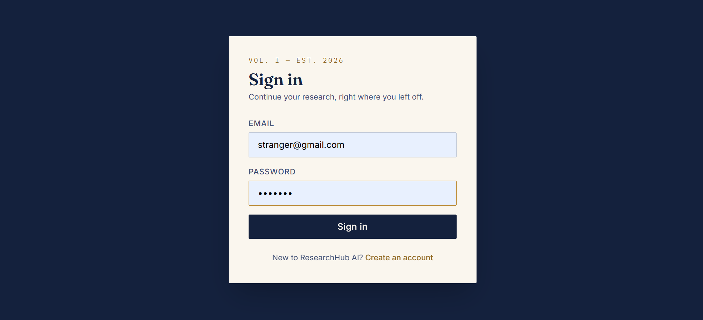
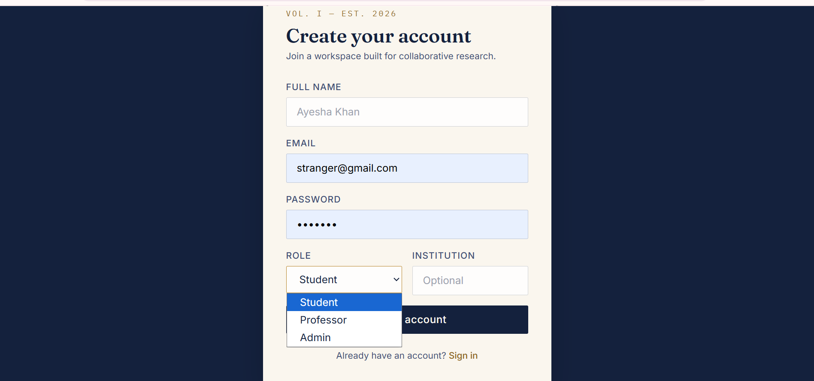
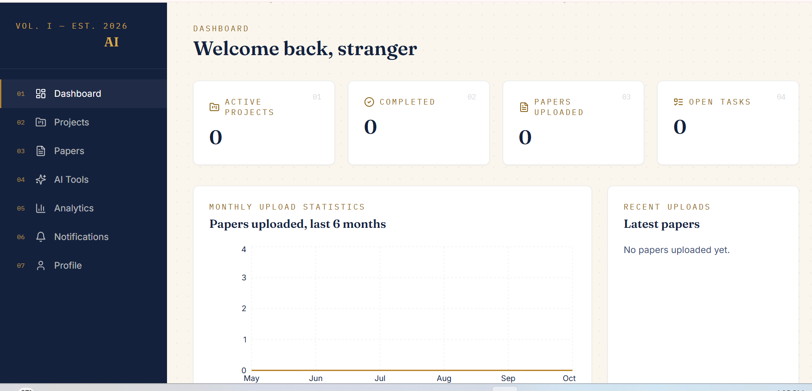
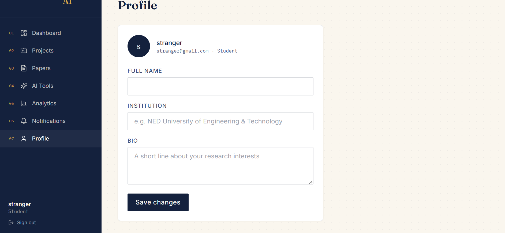
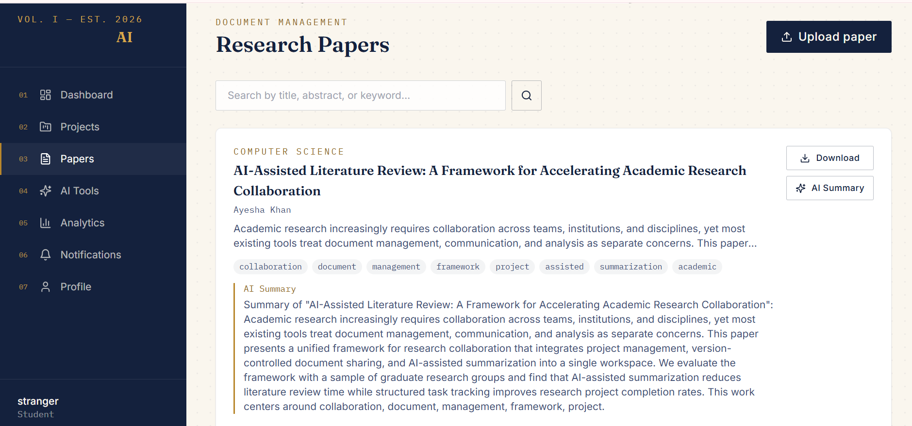
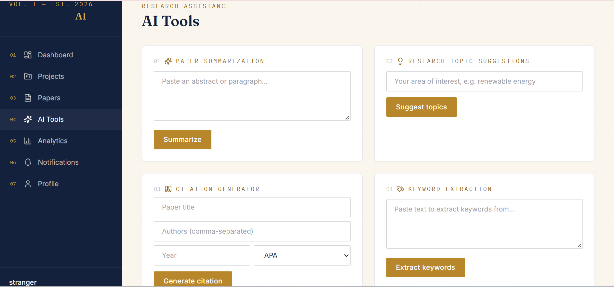

# ResearchHub AI: Research Collaboration Platform

A full-stack MERN web application that helps students, researchers, and professors manage research projects, share papers, generate citations, and collaborate, with AI-assisted research tools.

**Live demo:** https://researchhub-ai-kappa.vercel.app
(The backend runs on Render's free tier, so the first request may take 30-60 seconds to wake up.)

## Features

- **Authentication & Security**: JWT auth, bcrypt password hashing, role-based access (Admin / Professor / Student)
- **Research Collaboration**: create projects, invite team members, assign & track tasks, discussion panel
- **Research Paper Management**: upload papers, categorize, full-text search, version control, download
- **AI-assisted tools**: paper summarization, research topic suggestions, citation generator (APA/MLA/Chicago), keyword extraction
- **Dashboard & Analytics**: active/completed projects, monthly upload statistics, progress tracking, productivity reports
- **Notifications**: project invitations, task assignments, paper uploads

> The AI tools ship with a built-in **mock AI engine**, so the whole app works out of the box with zero API keys. Add an `OPENAI_API_KEY` and set `USE_MOCK_AI=false` in `backend/.env` to switch to real OpenAI-powered responses (see `backend/utils/aiService.js`).

## Screenshots








## Tech Stack

| Layer         | Technology                                            |
|---------------|-------------------------------------------------------|
| Frontend      | React.js, Vite, Tailwind CSS, Framer Motion, Recharts |
| Backend       | Node.js, Express.js, JWT, Multer, Nodemailer          |
| Database      | MongoDB (Atlas or local)                              |
| AI (optional) | OpenAI API                                            |
| Deployment    | Vercel (frontend), Render (backend)                   |

## Project Structure

```
researchhub-ai/
├── backend/
│   ├── config/          # MongoDB connection
│   ├── controllers/     # Route handlers
│   ├── middleware/      # Auth, role check, upload, error handler
│   ├── models/          # Mongoose schemas
│   ├── routes/          # Express routers
│   ├── utils/           # Token, email, AI helpers
│   ├── uploads/         # Uploaded paper files
│   └── server.js
└── frontend/
    └── src/
        ├── api/          # Axios instance
        ├── components/   # Reusable UI components
        ├── context/      # Auth context
        ├── layouts/      # Dashboard layout
        └── pages/        # Route pages
```

## Getting Started

### 1. Backend setup

```
cd backend
npm install
cp .env.example .env
# edit .env and set MONGO_URI + JWT_SECRET at minimum
npm run dev
```

The API runs on `http://localhost:5000`.

### 2. Frontend setup

```
cd frontend
npm install
npm run dev
```

The app runs on `http://localhost:5173` (Vite proxies `/api` and `/uploads` to the backend automatically).

### 3. MongoDB

- Easiest: create a free cluster on [MongoDB Atlas](https://www.mongodb.com/atlas), copy the connection string into `MONGO_URI` in `backend/.env`.
- Or run MongoDB locally and use `mongodb://localhost:27017/researchhub-ai`.

## Environment Variables (backend/.env)

See `backend/.env.example` for the full list. At minimum you need `MONGO_URI` and `JWT_SECRET` to run the app. Email and OpenAI are optional; without them the app falls back to console-logged emails and mock AI responses.

## Limitations

- The AI tools use a mock engine by default; real AI responses require an OpenAI API key (`USE_MOCK_AI=false`). The public demo may run in mock mode.
- Uploaded papers are stored on the server's local disk (`backend/uploads/`), which is not persistent on free hosting such as Render, so files may be lost after a restart.
- Email notifications require SMTP credentials; without them, emails are only logged to the console.

## Use Case

Universities, research institutes, laboratories, graduate students, professors, and collaborative research teams who need a single workspace to manage projects, papers, and AI-assisted research tasks.

## Author

Amna Shoaib, BS Information Technology, MNS University of Agriculture, Multan, Pakistan  
GitHub: [@amnashoaib2510-cloud](https://github.com/amnashoaib2510-cloud)

## License

MIT, free to use for portfolio, academic, or learning purposes.
